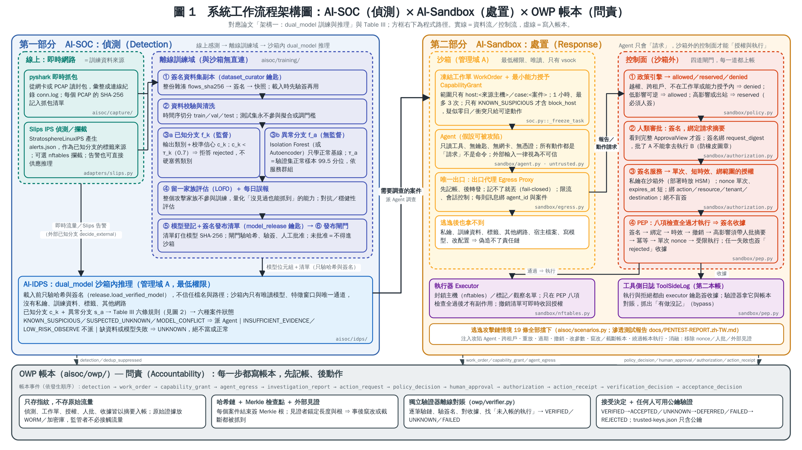
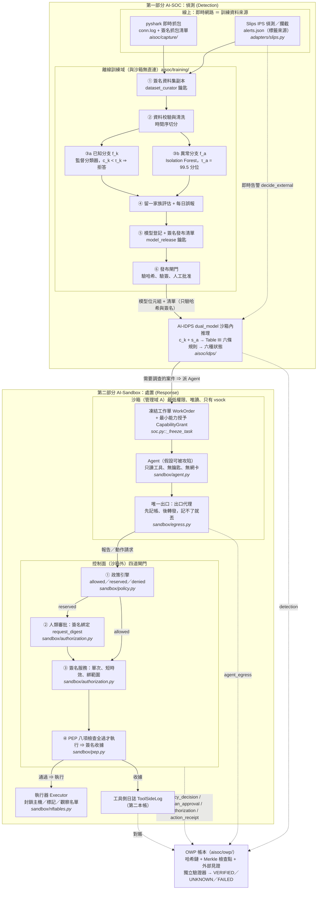
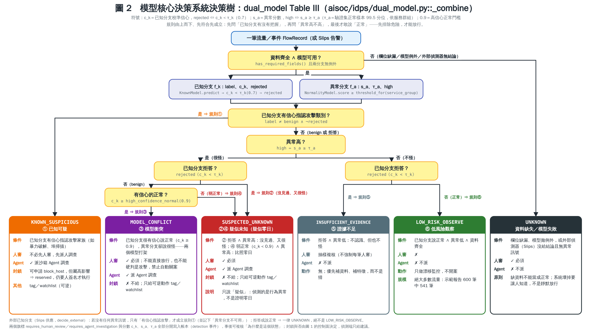
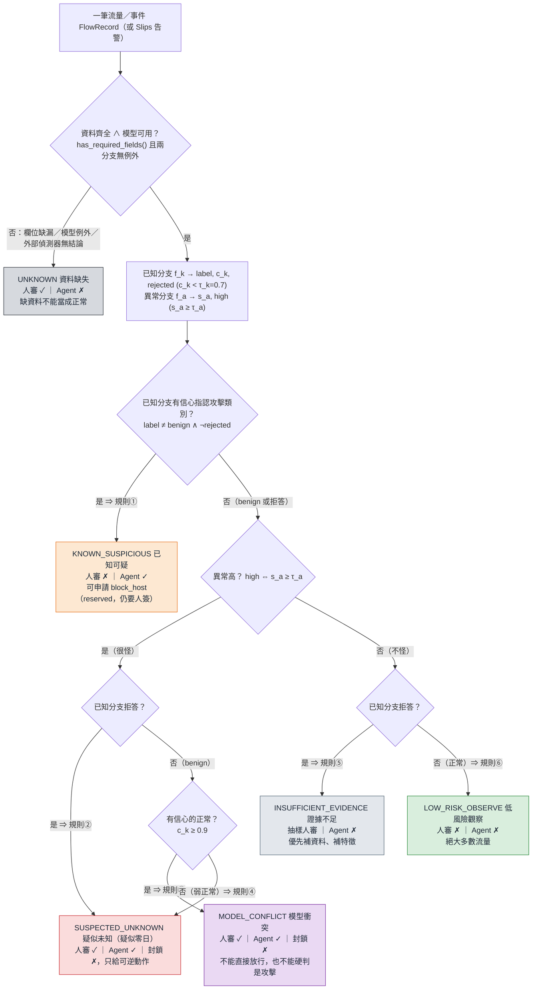

# 系統架構圖與決策樹（決賽 PPT 用）

兩張圖都由 `docs/diagrams/make_diagrams.py` 產生（純 Python 標準函式庫，不用安裝繪圖套件），
畫布 1920×1080（16:9，可直接放進 PPT），同時輸出 SVG（可編輯）與 PNG（2560 px 寬）。

| 圖 | 檔案 | 用途 |
|---|---|---|
| 圖 1 系統工作流程架構圖 | [`diagrams/architecture-1-workflow.png`](diagrams/architecture-1-workflow.png) · [SVG](diagrams/architecture-1-workflow.svg) | 答辯第 2 段「三道閘門／總架構」 |
| 圖 2 模型核心決策系統決策樹 | [`diagrams/decision-tree.png`](diagrams/decision-tree.png) · [SVG](diagrams/decision-tree.svg) | 答辯第 4 段「案例推演」；回答「怎麼證明是零日」 |

圖上每個方框右下角的灰色小字是對應的程式路徑；圖的內容與 `aisoc/` 的程式碼逐條對過
（規則來源：`aisoc/idps/dual_model.py::_combine`、`aisoc/soc.py::_run_case`／`_freeze_task`、
`aisoc/sandbox/policy.py`、`aisoc/sandbox/pep.py`）。改程式請同步改圖，改圖請同步改程式。

---

## 圖 1 系統工作流程架構圖：AI-SOC 與 AI-Sandbox 兩部分



### 怎麼讀這張圖

整張圖分三塊：**左邊第一部分 AI-SOC（偵測）**、**右邊第二部分 AI-Sandbox（處置）**、
**底部 OWP 帳本（問責）**。實線箭頭是資料流／控制流，虛線灰箭頭是「寫入帳本」。

1. **線上：即時網路（左上，綠）**
   Slips IPS 偵測即時流量產生 `alerts.json`；pyshark 抓包程式同時產生 Zeek 風格 `conn.log`
   與簽名的抓包清單（每個 PCAP 的 SHA-256）。兩者是訓練資料來源；Slips 告警也可直接送推理
   （`decide_external`，外部已知分支）。程式：`aisoc/capture/`、`aisoc/adapters/slips.py`。
2. **離線訓練域（左中，藍紫；論文「架構一」，詳見 [GUIDE §13](GUIDE.zh-TW.md#13-架構一離線訓練域從即時封包到簽名模型新手逐步版)）**
   ① 資料集整份雜湊並用 `dataset_curator` 鑰匙簽名，之後只讀；② 時間序切分 train／val／test、
   校驗清洗；③a 已知分支 f_k 是監督分類器，輸出類別＋校準信心 c_k，c_k < τ_k（0.7）就**拒答**；
   ③b 異常分支 f_a 是 Isolation Forest（或 Autoencoder），只學正常基線，門檻 τ_a 取驗證集正常樣本
   的 99.5 分位，依服務群組分別建；④ 留一家族評估（LOFO）量化「沒見過也能抓到」；
   ⑤ 模型雜湊寫進發布清單並用 `model_release` 鑰匙簽名；⑥ 發布閘門驗哈希、驗簽、**人批准**，
   未批准＝不得進沙箱。程式：`aisoc/training/`。
3. **沙箱內推理 AI-IDPS（左下）**
   載入前只驗哈希與簽名（`release.load_verified_model`），不信任檔名或路徑；沙箱內只有唯讀模型、
   特徵窗口與唯一通道。已知分支 c_k ＋ 異常分支 s_a → 六條規則 → 六種案件狀態（見圖 2）。
   只有 `requires_agent_investigation` 為真的案件才交給第二部分。程式：`aisoc/idps/`。
4. **沙箱（右上左欄，黃；管理域 A）**
   凍結工作單 WorkOrder ＋ 最小能力授予 CapabilityGrant（範圍只有 `host:<來源主機>`／
   `case:<案件>`，1 小時，最多 3 次；`block_host` 只在 KNOWN_SUSPICIOUS 才出現在清單）。
   Agent 假設可被攻陷：只有只讀工具、沒有鑰匙、沒有網卡；所有動作都是「請求」不是命令；
   外部輸入一律視為不可信。唯一出口是出口代理：**先記帳、後轉發，記不了就丟**（fail-closed）。
   逃逸後也拿不到私鑰、訓練資料、標籤、其他網路、宿主檔案。
   程式：`aisoc/soc.py::_freeze_task`、`aisoc/sandbox/agent.py`、`aisoc/sandbox/egress.py`。
5. **控制面（右上右欄，紅；沙箱外，四道閘門）**
   ① 政策引擎：越權、跨租戶、不在工作單或能力授予內 ⇒ `denied`；低影響可逆 ⇒ `allowed`；
   高影響或出站 ⇒ `reserved`（必須人簽）。② 人類審批看到完整 ApprovalView 才簽，簽名綁定
   `request_digest`（批了 A 不能拿去執行 B）。③ 簽名服務：私鑰在沙箱外，簽出單次 nonce、短
   `expires_at`、綁 action／resource／tenant／destination 的授權。④ PEP 八項檢查
   （簽名→綁定→時效→撤銷→高影響須人批→冪等→單次 nonce→受限執行）全過才執行，任一失敗也簽
   「rejected」收據。執行器（nftables 封鎖／標記／觀察名單）只在 PEP 之後才有副作用；
   工具側日誌是第二本帳，驗證器拿它與主帳本對賬，抓「有做沒記」。
   程式：`aisoc/sandbox/policy.py`、`authorization.py`、`pep.py`、`nftables.py`。
6. **OWP 帳本（底部，灰）**
   每一步都寫帳本，依發生順序：`detection → work_order → capability_grant → agent_egress →
   investigation_report → action_request → policy_decision → human_approval → authorization →
   action_receipt → verification_decision → acceptance_decision`。只存指紋不存原始流量；
   哈希鏈＋每案 Merkle 檢查點＋外部見證；獨立驗證器離線對賬 →
   VERIFIED／UNKNOWN／FAILED → ACCEPTED／DEFERRED／REJECTED。任何人用 `trusted-keys.json`
   裡的公鑰就能驗。程式：`aisoc/owp/`。

### 圖上箭頭 ↔ `AISOC._run_case` 步驟

| 圖上箭頭 | `_run_case` 步驟 | 帳本事件 |
|---|---|---|
| 流量／Slips 告警 → AI-IDPS | 步驟 1 偵測先上帳 | `detection`（不派 Agent 的案件到此結束） |
| 需要調查的案件 → 沙箱 | 步驟 3 去重、步驟 4 凍結 | `dedup_suppressed`／`work_order`、`capability_grant` |
| Agent → 出口代理 | 步驟 5～7 調查、報告與每個請求各自過出口 | `agent_egress`、`investigation_report`、`action_request` |
| 報告／動作請求 → 控制面 | 步驟 8 政策→人簽→簽名→PEP | `policy_decision`、`human_approval`、`authorization`、`action_receipt` |
| 控制面 → 帳本 | 步驟 9～11 檢查點、驗證、接受 | Merkle 檢查點、`verification_decision`、`acceptance_decision` |

### Mermaid 版（GitHub 直接渲染；想改字可以複製去改）



---

## 圖 2 模型核心決策系統決策樹（dual_model Table III）



### 符號

| 符號 | 意思 | 程式 |
|---|---|---|
| `c_k` | 已知分支校準後的信心（0～1） | `aisoc/idps/known_model.py`（溫度校準在驗證集上做） |
| `rejected` | `c_k < τ_k`，τ_k 預設 0.7：已知分支「拒答」 | `known_model.py:56`、`dual_model.py:148` |
| `s_a` | 異常分支分數，越高越怪 | `aisoc/idps/normality_model.py` |
| `τ_a`、`high` | 門檻＝驗證集正常樣本的 99.5 分位，依 `service_group` 分別建；`high ⇔ s_a ≥ τ_a` | `normality_model.py:105`、`threshold_for()` |
| `0.9` | 高信心正常門檻 `high_confidence_normal` | `dual_model.py:135` |

### 六種狀態一覽

規則**由上而下、先符合先成立**（`_combine` 裡就是一串 `if … return`）。
順序本身就是設計：先問「已知分支有沒有把握」，再問「異常高不高」，最後才敢說「正常」。

| # | 狀態 | 規則 | 條件 | 人審 | 派 Agent | 封鎖 | 白話 |
|---|---|---|---|---|---|---|---|
| 1 | `KNOWN_SUSPICIOUS` 已知可疑 | ① | label ≠ benign ∧ ¬rejected | 否 | **是** | 可申請 `block_host`，但屬高影響 ⇒ `reserved`，**仍要人簽名**才執行 | 已知分支認得這個攻擊家族（如暴力破解、埠掃描），不用先人審，直接派 Agent 查 |
| 2 | `SUSPECTED_UNKNOWN` 疑似未知（疑似零日） | ②、④ | ② rejected ∧ high；④ benign ∧ ¬rejected ∧ c_k < 0.9 ∧ high | **是** | **是** | 否，只給可逆動作（tag／watchlist） | 沒見過、又很怪；或只有弱的「正常」判斷卻很怪。只說「疑似」：偵測的是行為異常，不是證明零日 |
| 3 | `MODEL_CONFLICT` 模型衝突 | ③ | benign ∧ c_k ≥ 0.9 ∧ high | **是** | **是** | 否 | 已知分支很有信心說正常，異常分支卻說很怪——兩個模型打架。不能直接放行，也不能硬判是攻擊 |
| 4 | `INSUFFICIENT_EVIDENCE` 證據不足 | ⑤ | rejected ∧ ¬high | 抽樣 | 否 | — | 不認識、但也不怪。優先補資料、補特徵，而不是猜 |
| 5 | `LOW_RISK_OBSERVE` 低風險觀察 | ⑥ | 其餘（benign ∧ ¬high） | 否 | 否 | — | 絕大多數流量；示範報告 600 筆中 541 筆（GUIDE §5） |
| 6 | `UNKNOWN` 資料缺失 | 前置檢查 | 欄位缺漏／模型拋例外／外部偵測器沒給結論 | **是** | 否 | — | **缺資料不能當成正常**；系統壞掉要讓人知道，不是靜默放行 |

三個要點，答辯時常被問：

- **「怎麼證明是零日？」** 不證明。狀態名就叫 `SUSPECTED_UNKNOWN`：兩個模型都沒把握、
  行為又偏離基線，所以必須人審。零日是人審後的結論，不是模型的結論。
- **封鎖與否不是偵測端決定的。** 圖 2 只決定「要不要人審」「要不要派 Agent」兩個旗標與
  能力授予的範圍（`_freeze_task`）；真正能不能封鎖由圖 1 的控制面（政策 → 人簽 → 簽名 → PEP）決定。
- **外部已知分支（Slips 供應，`decide_external`）**：若沒有任何異常訊號，只有「有信心指認攻擊」
  才成立規則①（並記下「異常分支不可用」）；拒答或說正常 ⇒ 一律 `UNKNOWN`，**絕不是**
  `LOW_RISK_OBSERVE`——因為沒有第二個模型背書，不能放行。

兩個旗標 `requires_human_review`／`requires_agent_investigation`、分數 `c_k`／`s_a`／`τ_a`
與規則版本全部寫進帳本的 `detection` 事件，事後可以複核「為什麼是這個狀態」。

### Mermaid 版



---

## 重現與修改

```bash
# 只要 SVG（任何環境都行，純標準函式庫）
python docs/diagrams/make_diagrams.py --no-png

# 同時輸出 PNG：需要 rsvg-convert 與一套中文字型
sudo apt-get install -y librsvg2-bin fonts-wqy-zenhei
python docs/diagrams/make_diagrams.py
```

- 改文字：打開 `make_diagrams.py`，找 `figure_workflow()`（圖 1）或 `figure_decision_tree()`（圖 2），
  直接改字串即可；方框高度會依內容自動計算，排不下時腳本會在 stderr 印 `warning:`，
  再把文字縮短或調整 `PANEL_H`／`leaf_h` 等常數。
- 改顏色：檔案開頭的 `C_ONLINE`、`C_TRAIN`、`C_IDPS`、`C_SANDBOX`、`C_CTRL`、`C_LEDGER` 等調色盤（每個是「底色, 邊框色」）。
- 改規則：**先改 `aisoc/idps/dual_model.py::_combine` 並跑 `python -m pytest -q tests/test_dual_model.py`**，
  再改圖；圖只是程式的投影。

## 放進 PPT 的建議

- 直接插入 PNG（2560 px 寬，投影足夠清晰）；或插入 SVG 後在 PowerPoint 右鍵「轉換成圖形」，
  就能逐字、逐框修改，也能逐段出現做動畫（例如先出現第一部分，再出現第二部分，最後出現帳本）。
- 圖 1 講法（約 90 秒）：「左邊負責看，右邊負責做，下面負責記。看的人沒有鑰匙，做的人每一步要簽名，
  記的帳任何人拿公鑰都能驗。」
- 圖 2 講法（約 60 秒）：「先問已知模型認不認得，再問異常模型怪不怪，最後才敢說正常。
  兩個都沒把握又很怪，就是疑似零日——必須人審、只給可逆動作、不許直接封鎖。」
- 現場演示對應：改帳本一個位元組 → 驗證器 FAILED（圖 1 底部）；重放授權被 PEP 拒絕（圖 1 右欄 ④）；
  逃逸後仍簽不了名（圖 1 右上「逃逸後也拿不到」）。

## 誠實範圍

- 門檻 τ_k＝0.7、τ_a＝99.5 分位、0.9 都是**開發起點**，部署要在自家基線重新調；
  `quantile=0.995` 不是部署誤報率保證。
- 圖中「HSM」「vsock」「microVM」是論文建議的部署位置；本倉庫是參考實作，鑰匙是軟體金鑰、
  沙箱是程序內的能力限制（見 [`ARCHITECTURE.md`](ARCHITECTURE.md) §6「What this implementation does not show」）。
- 所有數字（600 筆中 541 筆、19 條逃逸情境）來自合成資料與受控迴路測試
  （[`PENTEST-REPORT.zh-TW.md`](PENTEST-REPORT.zh-TW.md)），不是真實網路的統計。
- 不要說「首創」；說「補上業界在可驗證問責上的缺口」。
